# Backend Development Fundamentals – Lab 3

## Student Details

- **Name:** Kattempudi Sai Charan
- **Registration Number:** 252U1R9151
- **Section:** CSE GEN AI 2C / 112

## Aim

To develop a REST API using Node.js, Express.js and SQLite that supports book-related CRUD operations, query parameters, searching, sorting, pagination, price-range filtering, input validation and appropriate HTTP status codes.

## Technologies Used

- Node.js
- Express.js
- JavaScript
- SQLite
- better-sqlite3
- Postman (API testing)
- Git and GitHub

## Project Structure

```text
Module-3 Lab-3/
├── screenshots/
│   ├── 01_GET_All_Books.png
│   ├── 02_GET_Book_By_ID.png
│   ├── 03_Search_Books.png
│   ├── 04_Sort_By_Price_DESC.png
│   ├── 05_Limit_Results.png
│   ├── 06_Offset_Results.png
│   ├── 07_Invalid_Order_By.png
│   ├── 08_Invalid_Sort_Order.png
│   ├── 09_Filter_By_Price_Range.png
│   ├── 10_POST_Missing_Title.png
│   ├── 11_POST_Missing_Author.png
│   ├── 12_POST_Invalid_Price.png
│   ├── 13_POST_Create_Book_201.png
│   ├── 14_PUT_Update_Book.png
│   ├── 15_PUT_Book_Not_Found.png
│   ├── 16_DELETE_Book.png
│   └── 17_DELETE_Book_Not_Found.png
├── .gitignore
├── books.db
├── package.json
├── package-lock.json
├── README.md
└── server.js
```

## Routes Implemented

| Method | Endpoint | Description | Response |
|---|---|---|---|
| GET | `/books` | Retrieve books with search, sorting, pagination and price filtering | HTTP 200 with JSON data |
| GET | `/books/:id` | Retrieve a specific book by ID | HTTP 200 or 404 |
| POST | `/books` | Add a new book after validating input | HTTP 201 or 400 |
| PUT | `/books/:id` | Update an existing book after validating input | HTTP 200, 400 or 404 |
| DELETE | `/books/:id` | Delete a book by ID | HTTP 200 or 404 |

### Query Parameters for GET `/books`

| Parameter | Description | Default Value |
|---|---|---|
| `search_q` | Search by partial book title | Empty string |
| `order_by` | Sort column: `book_id`, `title`, `author` or `price` | `book_id` |
| `order` | Sort direction: `ASC` or `DESC` | `ASC` |
| `limit` | Maximum number of records returned | `5` |
| `offset` | Number of records to skip | `0` |
| `min_price` | Minimum price for filtering | `0` |
| `max_price` | Maximum price for filtering | `10000` |

Example request:

```text
http://localhost:3000/books?search_q=Harry&order_by=price&order=DESC&limit=5&offset=0&min_price=100&max_price=1000
```

### Validation and Error Handling

- Returns HTTP 400 if the title or author is missing.
- Returns HTTP 400 if the price is missing or non-numeric.
- Returns HTTP 400 for an invalid sorting column or sorting direction.
- Returns HTTP 404 if the requested book ID does not exist.
- Returns HTTP 201 when a book is successfully created.
- Returns HTTP 200 when a book is successfully updated or deleted.
- Error responses use JSON messages.

## Running the Project Locally

### Prerequisites

Install Node.js and npm on your system.

### Installation

Clone the repository:

```bash
git clone https://github.com/saicharanx/Backend-Development-Fundamentals-Lab-Reports.git
```

Move into the project directory:

```bash
cd "Backend-Development-Fundamentals-Lab-Reports/Module-3 Lab-3"
```

Install the dependencies:

```bash
npm install
```

Start the server:

```bash
npm start
```

The server will run at:

`http://localhost:3000`

## Testing the Routes

Use Postman to test the following endpoints after starting the server:

- Get all books: `GET http://localhost:3000/books`
- Get a book by ID: `GET http://localhost:3000/books/1`
- Search books: `GET http://localhost:3000/books?search_q=Harry`
- Sort by price: `GET http://localhost:3000/books?order_by=price&order=DESC`
- Limit results: `GET http://localhost:3000/books?limit=2`
- Offset results: `GET http://localhost:3000/books?offset=2`
- Filter by price: `GET http://localhost:3000/books?min_price=100&max_price=1000`
- Add a book: `POST http://localhost:3000/books`
- Update a book: `PUT http://localhost:3000/books/1`
- Delete a book: `DELETE http://localhost:3000/books/1`

For POST and PUT requests, send the book details in JSON format:

```json
{
  "title": "The Alchemist",
  "author": "Paulo Coelho",
  "price": 350
}
```

## Screenshots

### GET All Books

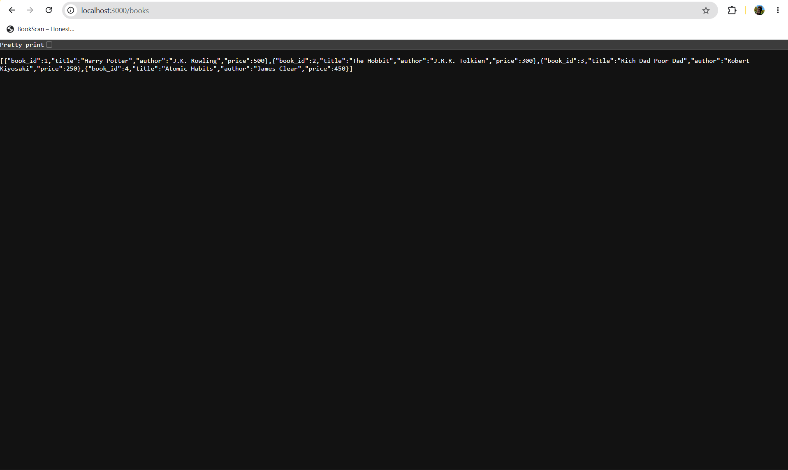

### GET Book By ID


### Search Books


### Sort By Price (Descending)

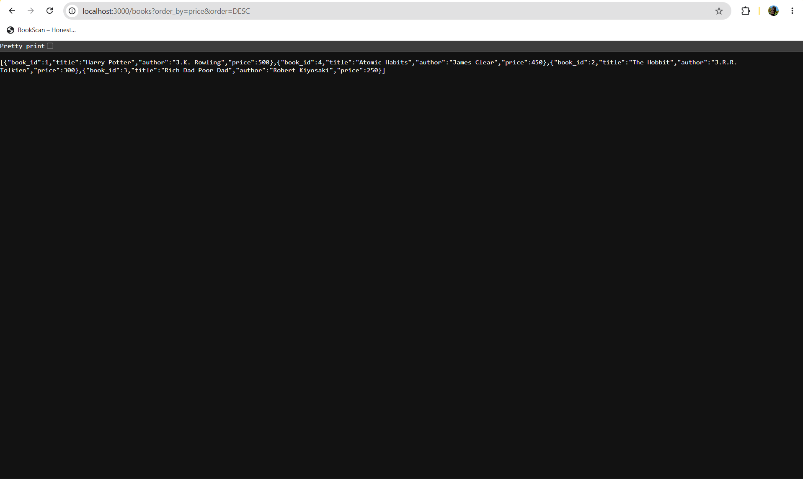

### Limit Results

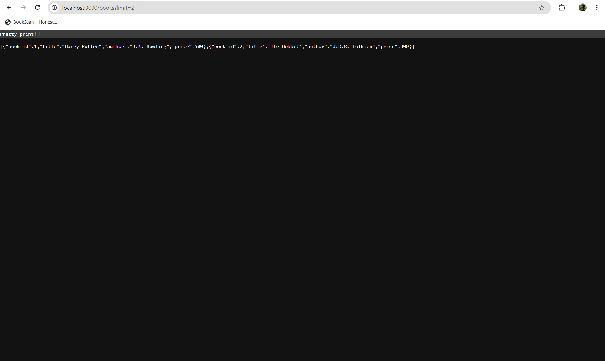

### Offset Results

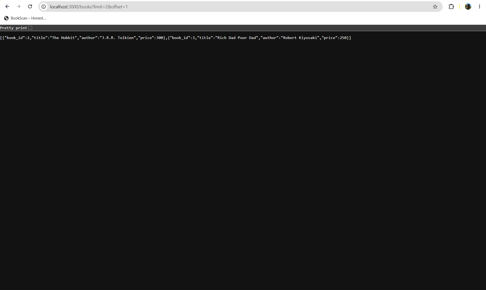

### Invalid Order By


### Invalid Sort Order


### Filter By Price Range

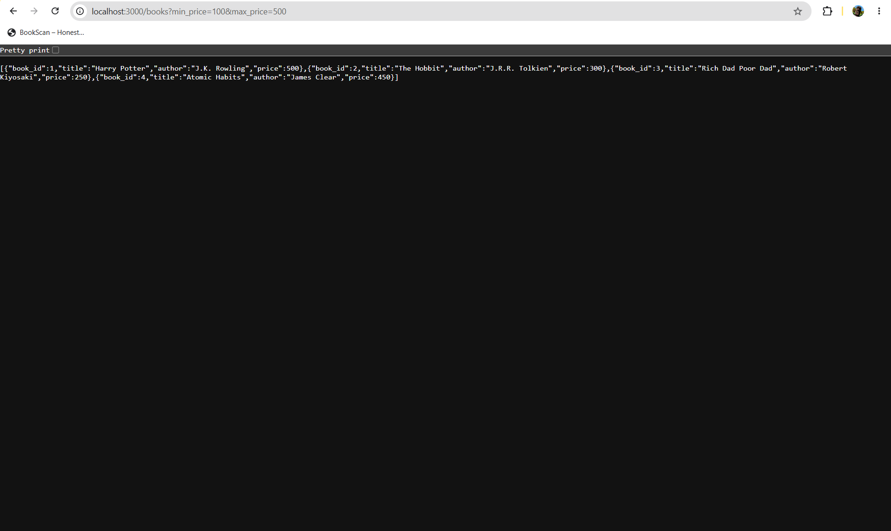

### POST – Missing Title

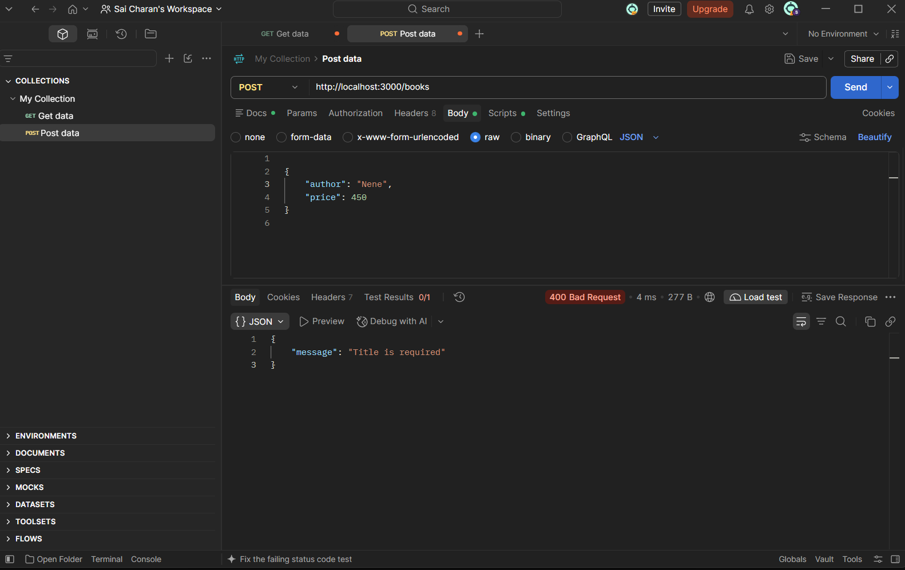

### POST – Missing Author

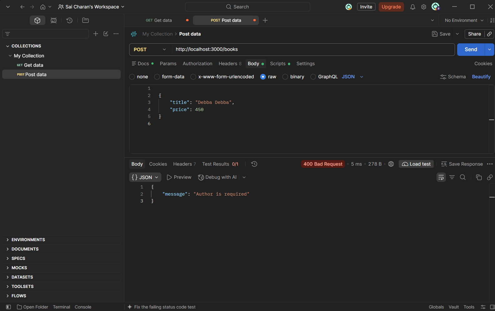

### POST – Invalid Price

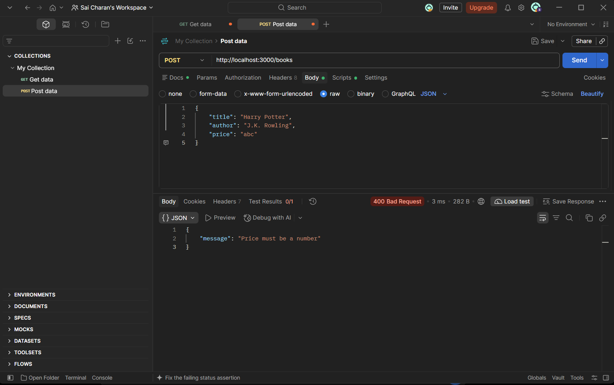

### POST – Create Book (201 Created)

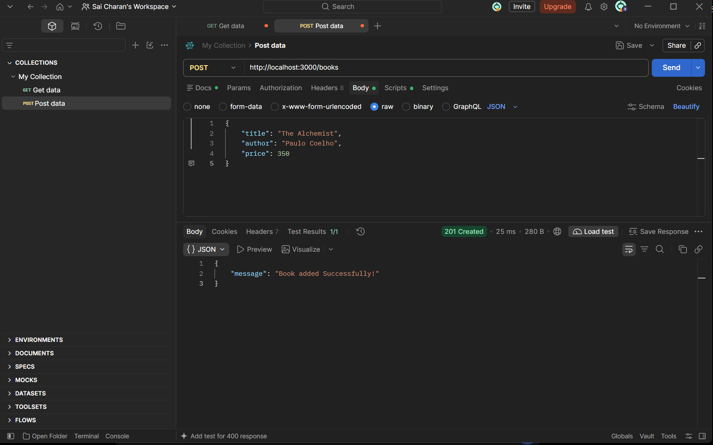

### PUT – Update Book

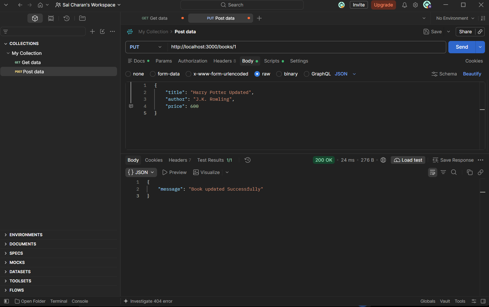

### PUT – Book Not Found

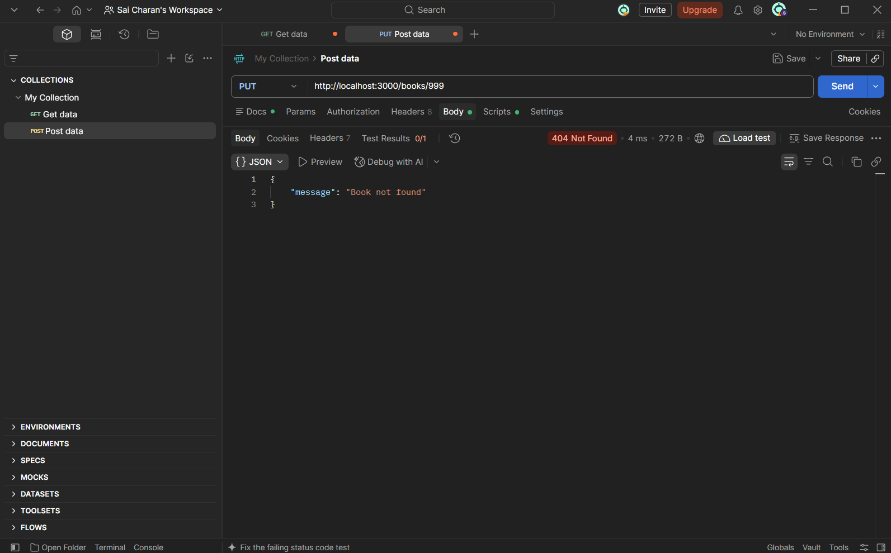

### DELETE – Book

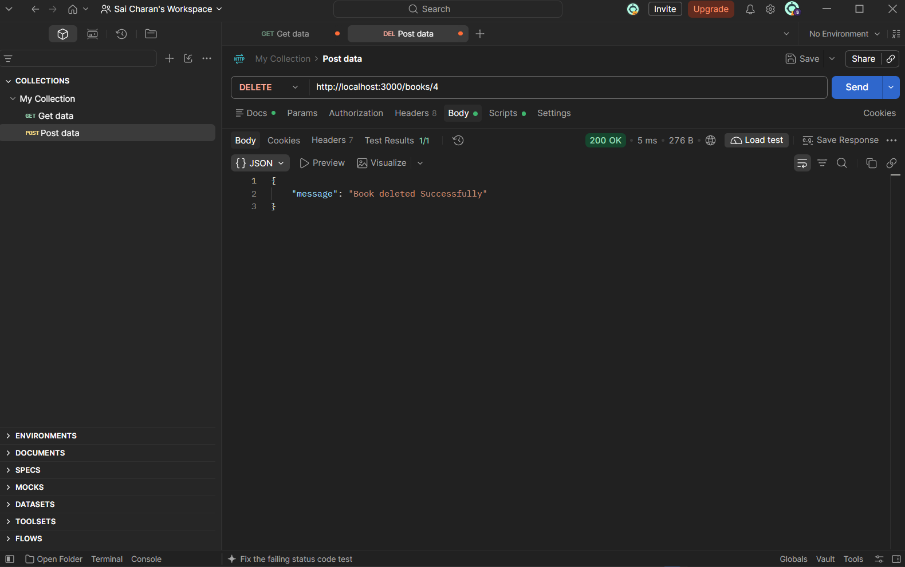

### DELETE – Book Not Found

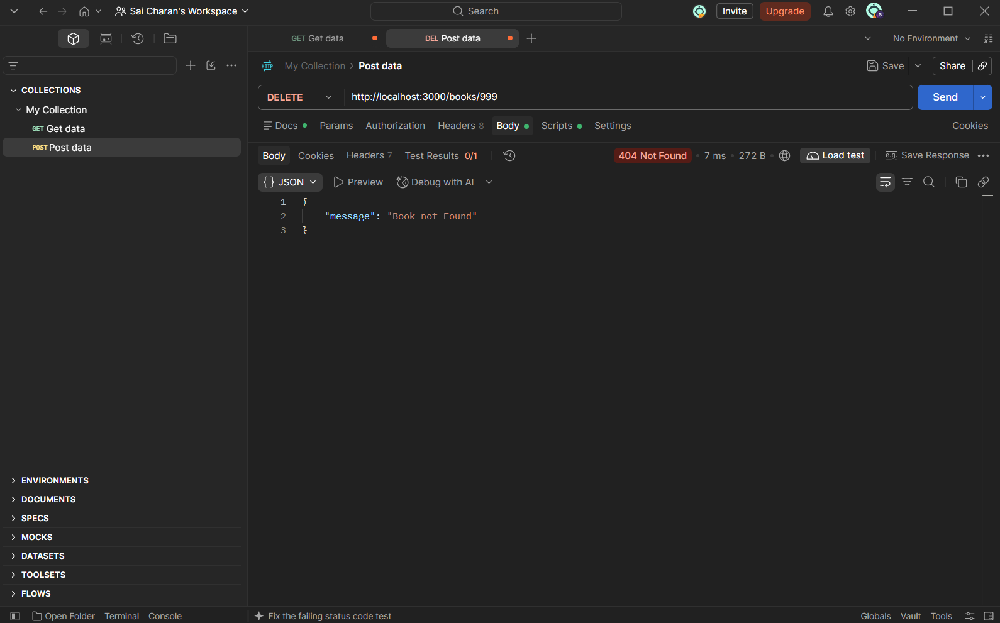

## Deployment

The application has not been deployed yet.

**Live Application:** Not applicable (local testing completed).

## GitHub Repository

[Backend Development Fundamentals – Lab Reports](https://github.com/saicharanx/Backend-Development-Fundamentals-Lab-Reports)

## Result

The REST API was implemented and tested successfully using Node.js, Express.js and SQLite. It supports book retrieval, creation, updating and deletion, along with searching, sorting, pagination, price-range filtering, input validation and appropriate HTTP status codes.
